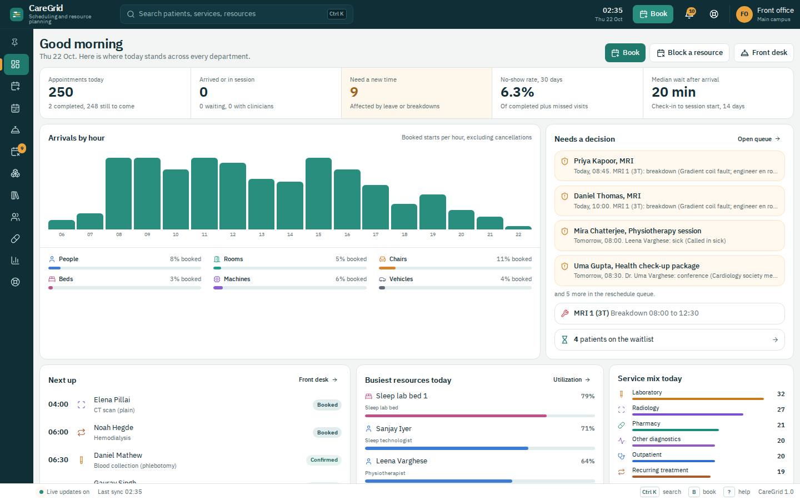

# CareGrid

Clinical appointment scheduling and resource planning for a whole healthcare network: hospital, outpatient clinics, diagnostics, theatres, dental, rehabilitation, pharmacy, home care, virtual care and more.

CareGrid books **every resource a service needs, minute by minute**: people, machines, rooms, chairs, beds and vehicles. Availability is calculated on demand from working hours, holidays, exceptions and existing bookings, so nobody has to maintain slots or check calendars every day.

| Layer | Stack |
|---|---|
| Frontend | Next.js 14 (App Router), React 18, TypeScript, Tailwind CSS |
| Backend | Express 4, TypeScript, Zod validation |
| Database | SQL (SQLite via better-sqlite3; schema is portable to PostgreSQL / MySQL) |
| Live updates | Server-Sent Events |



## Run it

Requires Node.js 20 or 22.

```bash
npm run setup     # installs root, backend and frontend packages
npm run dev       # API on http://localhost:4000, web app on http://localhost:3000
```

On first start the API creates `backend/data/caregrid.db` and seeds it automatically (about 10 seconds). To reset the demo data at any time:

```bash
npm run seed
```

Configuration (optional): copy `backend/.env.example` and `frontend/.env.example` to `.env` and adjust `PORT`, `DB_FILE`, `CORS_ORIGIN` and `NEXT_PUBLIC_API_URL`.

Production: `npm run build` then `npm start`.

## What is in the demo database

All mock data lives in SQL. Reference data is plain SQL in `backend/src/db/reference.sql`; activity is generated through the real scheduling engine so every mock booking obeys the same rules as a live one.

* 22 departments, 21 service categories, 185 appointment types with 534 resource requirements
* 430 resources (staff, machines, rooms, chairs, beds, vehicles) with 2,800+ weekly working windows: split shifts, alternate Saturdays, overnight sleep lab, 24x7 imaging and wards, reserved urgent and walk-in time
* 600 demo patients with language, interpreter, mobility, allergy and payer details
* About 5,700 appointments across five weeks (past visits with real check-in, start and finish times; future bookings; recurring dialysis and physiotherapy courses)
* A facility holiday, planned maintenance, leave, and live unplanned events (an MRI breakdown, a sick physiotherapist, a conference) that fill the reschedule queue
* Waitlist entries, reminder outbox and notifications

## Screens

| Screen | Purpose |
|---|---|
| Command center | Today at a glance: counts, arrivals by hour, utilization by resource type, items needing a decision, next patients, busiest resources |
| Book | Patient, service, time, book. Shows exactly which resources are reserved; next-available; routine or urgent; recurring courses; waitlist |
| Schedule board | Every resource as a timeline row with working time, reserved time, blocks, bookings, turnover and a live now-line. Click empty time to book that resource |
| Front desk | Patient flow board (expected, arrived, in session, finished) with one-click check-in, start, complete, no-show; waitlist; reminder outbox |
| Availability and blocks | Add leave, maintenance or breakdowns with an impact preview; reschedule queue with ranked alternatives and "fix all automatically"; facility holidays |
| Resources | Directory plus weekly working-hours editor (split shifts, overnight, alternate weeks, reserved windows), 7-day load, blocks, services that use it |
| Service catalog | All 185 services with their resource segments and editable rules (duration, step, notice, start window, preparation) |
| Patients | Demo patient records with upcoming and past visits |
| Pharmacy desk | Pickups, refills, counseling, INR, compounding and deliveries with counter load |
| Insights | Slot-length advice from real durations (median and 75th percentile) with one-click apply; utilization per resource |
| Help center | Concepts, screen guides, shortcuts; contextual help on every page with `?` |

Layout: header, footer, and a sidebar that is collapsed by default, expands on hover or click, and collapses again after you choose a page. Pages are full width with small margins, and the whole interface scales with screen size (tablet, 13", 15", 16" and larger). Shortcuts: `Ctrl/Cmd + K` search, `B` book, `?` help, `Esc` close.

## How scheduling works

**Availability layers.** For each resource: weekly template windows (with effective dates and alternate-week rotas) minus facility holidays (24x7 resources exempt) minus exceptions (one-off or repeating) minus existing holds. Nothing is pre-generated.

**Multi-resource requirements.** Each appointment type has requirement rows: role (or alternatives such as `psychologist|counselor`), offset from patient arrival, and duration. Examples:

* CT with contrast: prep bay and nurse 0 to 15 min, then scanner, radiographer and radiologist 15 to 30 min
* Chemotherapy: clean room and oncology pharmacist 45 minutes before arrival, then chair and nurse
* Holter: technician 15 min, recorder held for 24 hours
* Organ transplant: two theatres, two surgical teams, two anesthetists, perfusionist, then ICU bed

**Buffers and capacity.** Each role has a turnover time (OT cleaning 30 min, endoscope reprocessing 15 min, dialysis disinfection 30 min). Home visits add travel time before and after. Resources can serve several patients at once (a dialysis nurse covers three stations, the hyperbaric chamber seats six).

**Slot rules per service.** Start-time step, minimum notice, maximum advance days, earliest and latest start (fasting tests before 10:00, sleep studies 20:00 to 22:00), slot model (fixed, capacity, block, open), consent and preparation text.

**Reserved time.** Template windows can be tagged urgent or walk-in with a release time; routine bookings may use them only within that many hours of the start.

**Exceptions.** Saving a block finds every affected booking, flags it at risk and queues it with suggestions that stay close to the original time and keep the same team. Working-hour changes and new holidays do the same.

**Duration analytics.** Check-in, start and finish are captured at the front desk. Insights proposes a new slot length when the 75th percentile differs from the plan by 5 minutes or more.

## API overview (`http://localhost:4000/api`)

| Method | Path | Purpose |
|---|---|---|
| GET | `/meta` | Departments, categories, roles, kinds |
| GET | `/types`, `/types/:id` | Services with requirements; PATCH to change rules |
| GET | `/availability?typeId&from&days&priority&patientId&preferred` | Free slots with resource assignments, plus blockers when none |
| POST | `/appointments` | Book (re-validated atomically) |
| POST | `/appointments/series` | Book a recurring course |
| POST | `/appointments/:id/reschedule`, `/cancel`, `/status` | Move, cancel, confirm / check in / start / complete / no-show |
| GET | `/schedule?date&department&kind` | Timeline data for the board |
| GET/PUT | `/resources/:id`, `/resources/:id/templates` | Resource detail and weekly hours |
| POST | `/exceptions/preview`, `/exceptions` | Impact preview and create a block |
| GET/POST | `/queue`, `/queue/:id/suggestions`, `/queue/auto` | Reschedule queue |
| GET/POST | `/waitlist`, `/holidays`, `/reminders`, `/notifications` | Supporting data |
| GET | `/analytics/summary`, `/analytics/durations`, `/analytics/utilization` | Dashboards and insights |
| GET | `/events` | Server-Sent Events stream (notifications, schedule changes) |

## Project structure

```
backend/
  src/db/schema.sql         SQL schema (15 tables)
  src/db/reference.sql      Reference and demo master data (generated)
  src/db/seed.ts            Schema + reference + five weeks of activity
  src/engine/availability.ts Slot engine (windows, exceptions, holds, capacity, buffers)
  src/engine/booking.ts      Book, reschedule, cancel, lifecycle, series, waitlist, reminders
  src/engine/exceptions.ts   Impact preview, reschedule queue, suggestions, auto-resolve
  src/engine/analytics.ts    Duration analysis, utilization, dashboard
  src/routes/api.ts          REST API
  tools/generate_reference.py Regenerates reference.sql
frontend/
  src/app/*                  Pages
  src/components/shell       Header, sidebar, footer, notifications, command palette, help
  src/components/booking     Slot picker, appointment panel
  src/components/ui          Shared UI primitives
```

## Moving to PostgreSQL or MySQL

The schema uses standard SQL types. Replace `INTEGER PRIMARY KEY` with `SERIAL` / `AUTO_INCREMENT`, swap `better-sqlite3` for `pg` or `mysql2` in `backend/src/db/index.ts`, and make the query calls asynchronous. Date-times are stored as local facility time strings (`YYYY-MM-DDTHH:MM`) and work unchanged.

Patients are demo records. Connect a real patient master (EMR/HIS) and an authentication provider before using CareGrid with real data.
